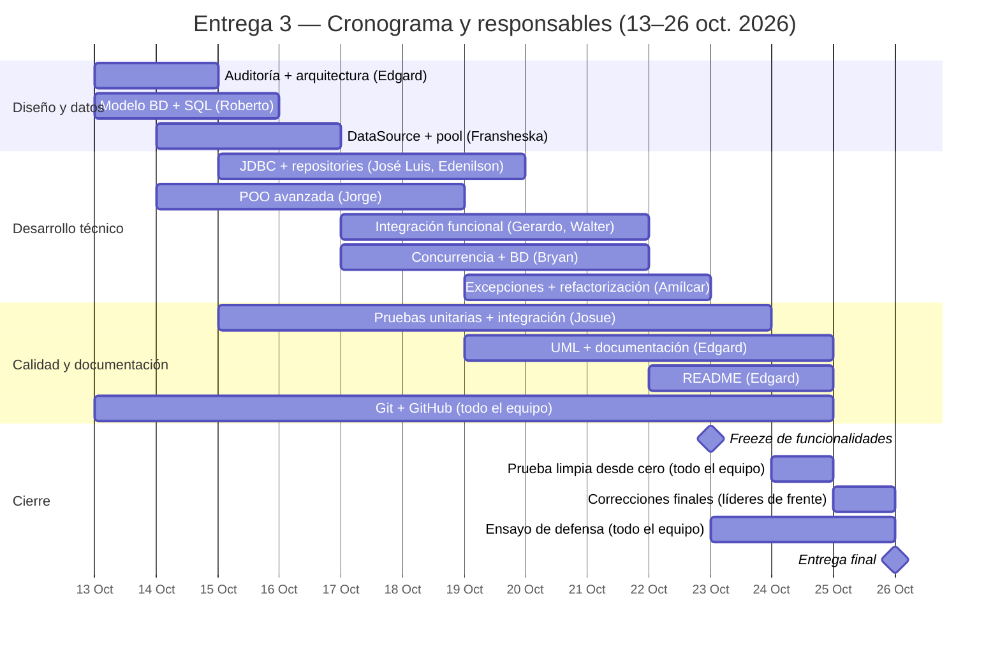

# Plan de Trabajo --- Entrega 3 (Final)

## Proyecto: Sistema de Gestión Académica

**Materia:** Programación II --- Ingeniería en Desarrollo de Software y
Ciencia de Datos\
**Repositorio:**
https://github.com/2602-Progra-II/prograii-sistema-gestion-academia\

**Base de trabajo:** rama `main`, correspondiente al cierre de la
Entrega 2\
**Rama de planificación base para este documento:** `feature/entrega3-edgard`

## 1. Propósito

Este documento establece el plan de trabajo para evolucionar el Sistema
de Gestión Académica desarrollado durante las Entregas 1 y 2 hacia la
versión final.

La Entrega 3 exige integrar y mejorar los avances anteriores
incorporando Programación Orientada a Objetos, herencia y polimorfismo,
clases abstractas e interfaces, colecciones y genéricos, programación
concurrente, arquitectura por capas, persistencia mediante JDBC, pool de
conexiones mediante `DataSource`, cohesión y bajo acoplamiento, manejo
de excepciones, pruebas unitarias, Git/GitHub y buenas prácticas de
desarrollo.

El trabajo se organizará en frentes técnicos relacionados. Cada frente
tendrá un responsable principal y colaboradores. Las actividades de
integración final, documentación, Git/GitHub y defensa serán
responsabilidades transversales del equipo.

## 2. Principios de organización

### 2.1 Evolución de la Entrega 2

La Entrega 3 no se plantea como un proyecto nuevo. Se utilizará como
línea base la versión entregada en la rama `main` al cierre de la
Entrega 2 y se evolucionará su arquitectura y funcionalidades.

### 2.2 Responsabilidad por frentes

Las actividades se agrupan por afinidad técnica. El responsable de cada
frente coordina el trabajo y entrega un resultado verificable, pero no
necesariamente realiza todas las modificaciones personalmente.

### 2.3 Trabajo colaborativo

Las tareas transversales no se asignarán como trabajo exclusivo de una
persona. Documentación, Git/GitHub, pruebas de integración, preparación
del entorno y defensa requieren participación del equipo.

### 2.4 Integración progresiva

Los cambios deberán integrarse progresivamente en `develop`. La rama
`main` se mantiene como referencia estable de la entrega anterior hasta
que la versión final de la Entrega 3 esté validada.

# 3. Frentes de trabajo

## Frente 1 --- Auditoría de E2 y arquitectura final (Edgard Granados)

**Actividades agrupadas:** 1 y 2.

**Objetivo:** determinar exactamente el estado de partida del proyecto y
definir la arquitectura objetivo para la Entrega 3.

**Actividades clave:** - Revisar la rama `main` entregada en E2. -
Ejecutar la aplicación y las pruebas existentes. - Inventariar
entidades, controllers, services, repositories y persistencia. -
Identificar funcionalidades completas, parciales y pendientes. - Revisar
las observaciones realizadas durante E2. - Identificar código que deberá
evolucionar para JDBC. - Definir responsabilidades de las capas. -
Determinar la ubicación de `config`, `exception`, `dto` y `util` cuando
corresponda. - Actualizar la propuesta de arquitectura.

**Resultado esperado:** diagnóstico de E2 y arquitectura objetivo de la
Entrega 3.

## Frente 2 --- Modelo relacional y scripts de base de datos (Roberto Gutierrez)

**Actividades agrupadas:** 3 y 4.

**Objetivo:** diseñar y materializar la base de datos relacional que
reemplazará la persistencia basada principalmente en memoria/archivos
utilizada en E2.

**Actividades clave:** - Revisar las entidades persistentes. - Definir
tablas y relaciones. - Definir claves primarias y foráneas. - Definir
restricciones y tipos de datos. - Revisar normalización. - Crear
`database/schema.sql`. - Crear `database/data.sql`. - Ejecutar ambos
scripts desde un entorno limpio. - Crear datos suficientes para probar
los módulos.

**Resultado esperado:** modelo relacional funcional, reproducible y
documentado.

## Frente 3 --- DataSource y pool de conexiones (Fransheska Benitez)

**Actividad agrupada:** 5.

**Objetivo:** implementar la infraestructura de `DataSource` y pool de
conexiones requerida por la entrega final.

**Actividades clave:** - Seleccionar la implementación del pool. -
Incorporar la dependencia correspondiente. - Crear `DataSourceConfig`. -
Configurar conexión a la BD. - Configurar parámetros del pool. -
Justificar los valores seleccionados. - Verificar obtención y devolución
de conexiones. - Implementar cierre adecuado de recursos. - Documentar
la configuración.

**Resultado esperado:** `DataSource` funcional y reutilizable por los
componentes JDBC.

## Frente 4 --- Infraestructura JDBC y repositories (Jose Luis Iraheta | Edenilson Amaya)

**Actividades agrupadas:** 6 y 7.

**Objetivo:** construir el acceso a datos mediante JDBC y migrar
progresivamente los repositories de E2 hacia la base de datos
relacional.

**Actividades clave:** - Implementar `Connection`. - Utilizar
`PreparedStatement`. - Utilizar `ResultSet`. - Implementar
`executeQuery()`. - Implementar `executeUpdate()`. - Implementar
inserción, consulta y actualización y/o eliminación. - Utilizar
`try-with-resources`. - Manejar errores JDBC. - Crear implementaciones
JDBC de los repositories necesarios. - Mapear resultados de BD hacia
entidades. - Sustituir progresivamente las fuentes de datos en
memoria. - Determinar qué componentes de `DataFileManager` dejan de ser
necesarios.

**Resultado esperado:** repositories capaces de operar sobre la BD
mediante JDBC.

## Frente 5 --- Integración funcional de módulos (Gerardo Gonzales | Walter Vasquez)

**Actividad agrupada:** 8.

**Objetivo:** completar los flujos funcionales que en E2 estaban
parcialmente implementados y conectar las diferentes capas de la
aplicación.

**Actividades clave:** - Completar matrícula. - Completar material
didáctico. - Completar actividades. - Completar entrega y
calificación. - Completar pagos. - Completar facturación. - Completar
reportes. - Eliminar operaciones pendientes o
`UnsupportedOperationException`. - Conectar Controller → Service →
Repository → JDBC. - Validar flujos de extremo a extremo. - Coordinar la
integración entre módulos relacionados.

**Resultado esperado:** módulos principales ejecutables de extremo a
extremo.

## Frente 6 --- POO avanzada: herencia, abstracción, interfaces y polimorfismo (Jorge Melendez)

**Actividades agrupadas:** 9 y 10.

**Objetivo:** cerrar las brechas de POO identificadas en E2 e incorporar
una jerarquía de especialización que tenga una justificación real dentro
del dominio.

**Actividades clave:** - Identificar una relación de especialización
válida. - Diseñar la clase abstracta cuando corresponda. - Crear clases
derivadas. - Implementar especialización de comportamiento. -
Implementar `override`. - Revisar y fortalecer las interfaces
existentes. - Utilizar referencias a tipos abstractos/interfaces. -
Demostrar comportamiento polimórfico. - Evitar jerarquías artificiales
creadas únicamente para satisfacer la rúbrica. - Documentar la decisión
de diseño.

**Resultado esperado:** implementación demostrable de herencia,
abstracción, interfaces y polimorfismo.

## Frente 7 --- Concurrencia integrada con base de datos (Bryan Reyes)

**Actividades agrupadas:** 11 y 12.

**Objetivo:** diseñar e implementar un proceso concurrente real del
sistema que interactúe con la base de datos mediante el `DataSource`.

**Actividades clave:** - Identificar una operación real que pueda
dividirse en tareas independientes. - Definir las tareas concurrentes. -
Seleccionar `Thread`, `Runnable` o `ExecutorService`. - Implementar las
tareas. - Obtener conexiones mediante `DataSource`. - Ejecutar consultas
desde las tareas concurrentes. - Manejar correctamente las conexiones. -
Controlar recursos compartidos. - Analizar posibles condiciones de
carrera. - Manejar excepciones. - Coordinar la finalización de las
tareas. - Documentar por qué la concurrencia es útil para el proceso
seleccionado.

**Resultado esperado:** concurrencia funcional, justificada y conectada
directamente con la BD.

## Frente 8 --- Excepciones, cohesión, acoplamiento y calidad estructural (Amilcar Crespin)

**Actividades agrupadas:** 13, 14 y 15.

**Objetivo:** realizar una revisión transversal del código para mejorar
el manejo de errores, la cohesión, el acoplamiento, la legibilidad y la
reutilización.

**Actividades clave:** - Revisar `try`, `catch`, `throw` y `throws`. -
Utilizar excepciones propias cuando corresponda. - Manejar excepciones
JDBC. - Diferenciar errores técnicos de errores de negocio. -
Identificar clases con buena cohesión. - Identificar dependencias que
puedan reducirse. - Revisar responsabilidades excesivas. - Eliminar
código duplicado. - Revisar nombres de clases y métodos. - Extraer
métodos cuando sea necesario. - Mejorar reutilización. - Revisar
organización de paquetes. - Documentar al menos un caso de mejora
antes/después.

**Resultado esperado:** código más cohesionado, menos acoplado, más
legible y con manejo consistente de errores.

## Frente 9 --- Pruebas unitarias y de integración (Josue Erazo)

**Actividades agrupadas:** 16 y 17.

**Objetivo:** ampliar la estrategia de pruebas para verificar
componentes individuales y los principales flujos integrados con la base
de datos.

**Actividades clave:** - Revisar las pruebas existentes. - Probar
Services. - Probar Controllers. - Probar utilidades. - Probar
validaciones. - Probar reglas de negocio. - Probar casos exitosos. -
Probar casos de error. - Utilizar assertions apropiadas. - Utilizar
Mockito cuando sea necesario. - Crear pruebas de persistencia. - Crear
pruebas de integración. - Probar flujos principales con una BD de
prueba. - Probar la concurrencia integrada con BD.

**Resultado esperado:** suite de pruebas automatizadas que verifique
comportamiento correcto y manejo de errores.

# 4. Actividades transversales del equipo

## 4.1 Actualización del UML y documentación técnica (Edgard Granados)

**Actividad:** 18.

El UML y la documentación deberán actualizarse conforme avance la
implementación. El responsable editorial coordinará la recopilación de
información de cada frente.

Debe documentarse, como mínimo: - arquitectura; - UML actualizado; -
encapsulamiento; - herencia; - polimorfismo; - abstracción; -
interfaces; - colecciones y genéricos; - concurrencia; - JDBC; -
DataSource; - pool; - cohesión y acoplamiento; - legibilidad y
reutilización; - excepciones; - pruebas; - Git/GitHub.

## 4.2 README del proyecto (Edgard Granados)

**Actividad:** 19.

El README deberá permitir que una persona externa pueda comprender y
ejecutar el proyecto.

Debe incluir: - nombre del proyecto; - integrantes; - tecnologías; -
requisitos; - configuración de BD; - instrucciones de ejecución; -
ejecución de pruebas; - credenciales de prueba, si aplican; -
descripción de la concurrencia; - URL del repositorio.

## 4.3 Git y GitHub (All)

**Actividad:** 20.

El control de versiones es responsabilidad de todos los integrantes.
Cada persona debe evidenciar trabajo real mediante commits y
participación en la evolución del proyecto.

La integración deberá realizarse mediante las ramas definidas por el
equipo y con revisión antes de integrar cambios en `develop`.

## 4.4 Prueba final desde cero (Edgard Granados)

**Actividad:** 21.

El equipo deberá realizar una instalación limpia del proyecto para
comprobar que las instrucciones del README son suficientes.

Debe verificarse: - clonación del repositorio; - instalación de
dependencias; - configuración de BD; - ejecución de `schema.sql`; -
carga de `data.sql`; - ejecución del sistema; - ejecución de pruebas; -
ejecución de los flujos principales; - ejecución de la funcionalidad
concurrente.

## 4.5 Defensa final (All)

**Actividad:** 22.

La defensa es responsabilidad individual de todos los integrantes. Cada
integrante debe conocer el funcionamiento general del proyecto, no
solamente las funcionalidades que desarrolló personalmente.

El equipo debe preparar preguntas y respuestas sobre: - arquitectura; -
POO; - herencia; - polimorfismo; - clases abstractas; - interfaces; -
colecciones; - JDBC; - DataSource; - pool; - concurrencia; -
excepciones; - pruebas; - Git/GitHub; - decisiones de diseño.

# 5. Distribución propuesta de los 11 integrantes

La siguiente tabla permite asignar manualmente un responsable principal a cada frente de trabajo. El número de integrantes indica cuántas personas deberían participar directamente en cada frente; cuando el número es 2, se recomienda designar un responsable principal y un colaborador.

| # | Frente de trabajo | Integrantes | Responsable(s) designado(s) |
|---:|---|---:|---|
| 1 | Auditoría E2 + arquitectura | 1 | Edgard Granados |
| 2 | Modelo BD + SQL | 1 | Roberto Gutierrez |
| 3 | DataSource + pool | 1 | Fransheska Benitez |
| 4 | JDBC + repositories | 2 | José Luis Erazo / Edenilson Amaya |
| 5 | Integración funcional | 2 | Gerardo Gonzales / Walter Vasquez |
| 6 | POO avanzada | 1 | Jorge Melendez |
| 7 | Concurrencia + BD | 1 | Bryan Reyes |
| 8 | Excepciones + calidad/refactorización | 1 | Amílcar Crespín |
| 9 | Pruebas | 1 | Josue Erazo |
| **Total** | | **11** | |

Las actividades de documentación, README, Git/GitHub, prueba final y
defensa se consideran responsabilidades transversales del equipo.

# 6. Estrategia de ramas

La evolución de la Entrega 3 deberá mantener una separación clara entre
la versión estable de la Entrega 2 y el desarrollo de la entrega final:

``` text
main
  │
  │ Versión estable de Entrega 2
  │
  ▼
develop
  │
  ├── feature/...
  ├── feature/...
  ├── feature/...
  └── feature/...
```

`main` representa la versión estable entregada en E2.

`develop` será la rama de integración de la Entrega 3.

Las ramas `feature/*` contendrán el desarrollo de cada frente de
trabajo.

Los cambios deberán integrarse progresivamente en `develop`. La
integración definitiva hacia `main` se realizará cuando el proyecto
final haya sido probado y validado.

# 7. Cronograma acelerado de la Entrega 3

**Periodo de ejecución:** del 13 al 26 de octubre de 2026.  
**Fecha límite de entrega:** lunes 26 de octubre de 2026.  
**Fecha objetivo de cierre técnico (freeze):** viernes 23 de octubre.  
**Responsable de coordinación y seguimiento:** Edgard Granados, con compromiso de los 11 integrantes.

Como el trabajo comenzará el 13 de octubre, quedan únicamente 14 días calendario hasta la entrega. Por tanto, este cronograma es intensivo y exige trabajo en paralelo, entregables parciales diarios y decisiones técnicas rápidas. No es viable ejecutar las 22 actividades una después de otra. Las fechas siguientes son límites internos de planificación, no una garantía de que la carga sea pequeña.

## 7.1 Calendario por frente

| Frente o actividad | Inicio | Fecha límite interna | Entregable o condición de salida |
|---|---|---|---|
| 1. Auditoría E2 + arquitectura | 13 oct. | 14 oct. | Diagnóstico breve, arquitectura acordada y alcance mínimo cerrado |
| 2. Modelo relacional + scripts SQL | 13 oct. | 15 oct. | `schema.sql` y `data.sql` ejecutables desde una BD limpia |
| 3. DataSource + pool | 14 oct. | 16 oct. | Conexión validada y configuración documentada |
| 4. JDBC + repositories | 15 oct. | 19 oct. | Operaciones JDBC mínimas funcionales en los repositories prioritarios |
| 5. Integración funcional de módulos | 17 oct. | 21 oct. | Flujos principales integrados de extremo a extremo |
| 6. POO avanzada | 14 oct. | 18 oct. | Herencia, clase abstracta, interfaces y polimorfismo demostrables |
| 7. Concurrencia + BD | 17 oct. | 21 oct. | Caso concurrente funcional que obtenga conexiones del `DataSource` |
| 8. Excepciones + calidad/refactorización | 19 oct. | 22 oct. | Errores principales controlados y mejoras de calidad aplicadas |
| 9. Pruebas unitarias e integración | 15 oct. | 23 oct. | Pruebas ejecutadas; errores críticos corregidos o registrados |
| UML y documentación técnica | 19 oct. | 24 oct. | Documentación consistente con el código realmente implementado |
| README | 22 oct. | 24 oct. | Instrucciones de instalación, configuración, ejecución y pruebas |
| Git/GitHub e integración | 13 oct. | 24 oct. | Commits y PR revisados; `develop` integrado y estable |
| Congelamiento de funcionalidades | 23 oct. | 23 oct. | No se agregan funcionalidades nuevas después de esta fecha |
| Prueba limpia desde cero | 24 oct. | 24 oct. | Clonación, configuración, scripts, ejecución y pruebas verificadas |
| Correcciones finales y validación | 25 oct. | 25 oct. | Incidencias críticas corregidas y versión candidata identificada |
| Preparación y ensayo de defensa | 23 oct. | 25 oct. | Cada integrante puede explicar el sistema y su contribución |
| Entrega final | 26 oct. | 26 oct. | Versión, documentación y evidencias listas para entregar |

## 7.2 Diagrama de Gantt

El diagrama se mantiene en Mermaid para que GitHub pueda renderizarlo directamente desde este archivo Markdown.



## 7.3 Hitos de control obligatorios

- **14 de octubre — Diseño cerrado:** el equipo debe haber acordado la arquitectura mínima, el alcance funcional prioritario y el modelo de datos preliminar.
- **16 de octubre — Conexión a BD validada:** los scripts deben ejecutarse y el `DataSource` debe obtener una conexión válida. Si esto no ocurre, los responsables de BD, pool y JDBC deben priorizarlo sobre mejoras secundarias.
- **19 de octubre — JDBC operativo:** al menos los repositories prioritarios deben realizar operaciones reales contra la base de datos.
- **21 de octubre — Integración funcional:** los flujos seleccionados deben recorrer Controller → Service → Repository → BD; la concurrencia debe tener una primera versión ejecutable.
- **23 de octubre — Freeze técnico:** solo se aceptan correcciones, pruebas y ajustes imprescindibles. No se incorporan nuevas funcionalidades por conveniencia.
- **24 de octubre — Prueba desde cero:** otra persona del equipo debe seguir el README en un entorno limpio y registrar cualquier bloqueo.
- **25 de octubre — Candidato final:** corregir los bloqueos críticos, verificar la rama de entrega y preparar las evidencias.
- **26 de octubre — Entrega:** reservar el día para entregar y verificar archivos; no planificar desarrollo nuevo para esta fecha.

## 7.4 Reglas de trabajo para cumplir el plazo

1. **Trabajo en paralelo desde el primer día.** Auditoría/arquitectura, modelo de datos y diseño POO avanzan en paralelo con acuerdos mínimos compartidos.
2. **Integración diaria.** Cada responsable debe subir avances pequeños y verificables; no acumular cambios hasta el final.
3. **Pruebas desde el inicio.** Cada módulo se prueba al desarrollarse. El bloque de pruebas del Gantt no significa que se deba esperar hasta esas fechas para probar.
4. **Priorizar un flujo funcional vertical.** Primero debe funcionar un recorrido completo con BD; después se amplía al resto de módulos. Si no alcanza el tiempo, el equipo debe priorizar los requisitos obligatorios de la rúbrica y dejar mejoras no esenciales fuera del alcance.
5. **Evitar cambios incompatibles.** Los responsables de BD/JDBC deben comunicar temprano nombres de tablas, columnas, interfaces y contratos de repository.
6. **No confundir “compila” con “está terminado”.** Cada hito requiere evidencia: scripts ejecutados, conexión real, pruebas ejecutadas y flujos demostrados.
7. **Protección del cierre.** El 24 y 25 de octubre se reservan para validación y correcciones, no para rediseñar la arquitectura.

## 7.5 Fechas clave

Estas fechas funcionan como puntos de control del equipo. Si un entregable no está listo en la fecha indicada, el responsable debe comunicar el bloqueo ese mismo día y acordar una acción correctiva con los frentes dependientes.

| Fecha | Hito clave | Evidencia requerida |
|---|---|---|
| **13 de octubre** | Inicio coordinado del proyecto | Responsables confirmados, ramas de trabajo activas y tareas iniciales distribuidas |
| **14 de octubre** | Arquitectura y alcance definidos | Diagnóstico de E2, arquitectura mínima acordada y funcionalidades prioritarias identificadas |
| **15 de octubre** | Modelo de datos listo | `schema.sql` y `data.sql` creados y ejecutados en una base de datos limpia |
| **16 de octubre** | Conexión a la base de datos validada | `DataSource` obtiene y devuelve una conexión correctamente |
| **19 de octubre** | JDBC operativo en repositories prioritarios | Consultas y operaciones de escritura ejecutadas contra la base de datos |
| **21 de octubre** | Integración funcional y concurrencia inicial | Al menos un flujo completo de negocio y una operación concurrente ejecutables |
| **22 de octubre** | Calidad y excepciones revisadas | Errores críticos controlados y pruebas principales ejecutadas |
| **23 de octubre** | **Freeze de funcionalidades** | No se aceptan funcionalidades nuevas; solo correcciones y ajustes imprescindibles |
| **24 de octubre** | Prueba de instalación desde cero | Clonación, configuración, scripts, ejecución y pruebas verificadas siguiendo el README |
| **25 de octubre** | Versión candidata final | Bloqueos críticos resueltos, documentación revisada y evidencias preparadas |
| **26 de octubre** | **Entrega final** | Repositorio y documentación listos para entregar y verificar |

**Regla de escalamiento:** las fechas del 16, 19 y 21 de octubre son hitos técnicos críticos. Si no se cumplen, se debe reducir el alcance de funcionalidades secundarias y concentrar el esfuerzo en los requisitos obligatorios de la evaluación. El 23 de octubre no se debe mover el freeze salvo que una corrección sea indispensable para que el sistema compile o ejecute un requisito obligatorio.

# 8. Secuencia recomendada de ejecución

1.  Auditoría de E2.
2.  Definición de arquitectura final.
3.  Diseño de base de datos.
4.  Creación de `schema.sql` y `data.sql`.
5.  Implementación de `DataSource` y pool.
6.  Implementación de infraestructura JDBC.
7.  Migración de repositories.
8.  Integración funcional de módulos.
9.  Implementación de herencia y clases abstractas.
10. Consolidación de polimorfismo e interfaces.
11. Diseño de la solución concurrente.
12. Implementación de concurrencia integrada con BD.
13. Fortalecimiento de excepciones.
14. Revisión de cohesión y acoplamiento.
15. Refactorización de legibilidad y reutilización.
16. Ampliación de pruebas unitarias.
17. Pruebas de integración.
18. Actualización del UML y documentación.
19. Actualización del README.
20. Revisión de Git/GitHub.
21. Prueba de instalación y ejecución desde cero.
22. Preparación de la defensa final.

Las actividades pueden ejecutarse parcialmente en paralelo cuando sus
dependencias lo permitan, pero la migración a JDBC, DataSource y base de
datos debe preceder a la implementación definitiva de la concurrencia
integrada con BD.

# 9. Criterios de cierre

Antes de considerar terminada la Entrega 3, el equipo deberá comprobar
que:

-   La aplicación utiliza una base de datos relacional mediante JDBC.
-   Los repositories principales utilizan `DataSource`.
-   Existe un pool de conexiones correctamente configurado.
-   Se ejecutan operaciones CRUD.
-   Existe herencia y especialización justificadas.
-   Existe polimorfismo.
-   Existen clases abstractas e interfaces utilizadas de forma
    significativa.
-   Se utilizan colecciones y genéricos.
-   Existe concurrencia integrada con la BD.
-   La concurrencia utiliza correctamente el `DataSource` y las
    conexiones.
-   Se manejan excepciones técnicas y de negocio.
-   Se evidencia cohesión y bajo acoplamiento.
-   Se documenta al menos una mejora de legibilidad/reutilización
    antes/después.
-   Existen pruebas unitarias y de integración.
-   El repositorio contiene la versión final actualizada.
-   El README permite ejecutar el proyecto.
-   El UML representa el código final.
-   Todos los integrantes conocen el proyecto completo para la defensa.

# 10. Referencia de la entrega

**Repositorio oficial:**
https://github.com/2602-Progra-II/prograii-sistema-gestion-academia

**Documento base:** Entrega final proyecto --- Programación II.

**Evaluación:** Proyecto 8 puntos + defensa 2 puntos.
